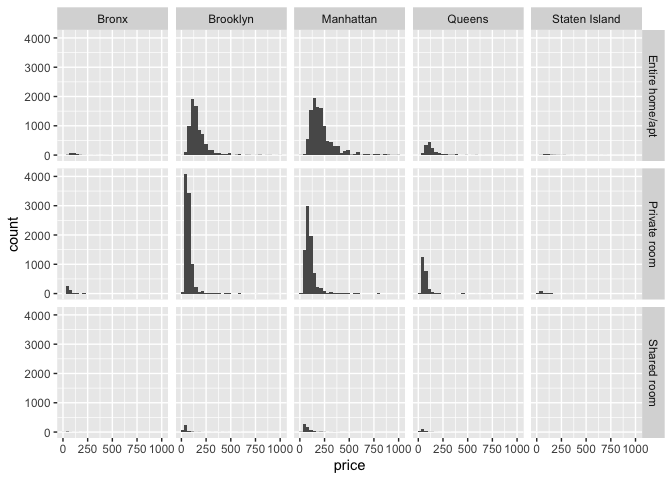
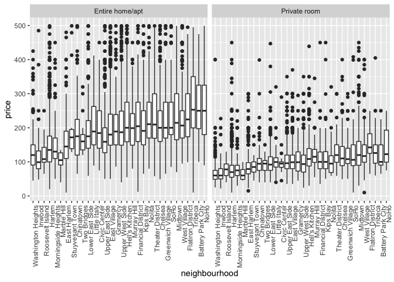

case_study
================
Lauren Holley
2026-10-13

``` r
library(tidyverse)
```

``` r
library(p8105.datasets)

data("nyc_airbnb")
```

## Some questions for consideration

- Where are the most expensive airbnbs in NYC?
- Which neighborhood has the highest concentration?
- Which is the cheapest?
- Which airbnb hosts are the most / best reviewed?
- Has the number increased or decreased over time?
- Do airbnbs affect rent in their neighborhoods / buildings?
- Do descriptions corrlate with price?
- What about text reviews?

``` r
nyc_airbnb |>
  mutate(stars = review_scores_location / 2)
```

    ## # A tibble: 40,753 × 18
    ##          id review_scores_location name    host_id host_name neighbourhood_group
    ##       <dbl>                  <dbl> <chr>     <dbl> <chr>     <chr>              
    ##  1  7949480                     10 City I…  1.19e5 Linda & … Bronx              
    ##  2 16042478                     NA WATERF…  9.12e6 Collins   Bronx              
    ##  3  1886820                     NA Quaint…  9.82e6 Steve     Bronx              
    ##  4  6627449                     10 Large …  1.39e7 Arlene    Bronx              
    ##  5  5557381                     10 Quaint…  2.88e7 Phoebe    Bronx              
    ##  6  9147025                     10 Cozy C…  4.03e5 Diane     Bronx              
    ##  7 11675715                     10 Cozy 1…  5.67e7 Josue     Bronx              
    ##  8   715270                      9 2 Beds…  3.68e6 Enrique   Bronx              
    ##  9 17876530                     10 Spacio…  1.13e7 Yahaira   Bronx              
    ## 10   182177                      9 PRIVAT…  8.73e5 Christia… Bronx              
    ## # ℹ 40,743 more rows
    ## # ℹ 12 more variables: neighbourhood <chr>, lat <dbl>, long <dbl>,
    ## #   room_type <chr>, price <dbl>, minimum_nights <dbl>,
    ## #   number_of_reviews <dbl>, last_review <date>, reviews_per_month <dbl>,
    ## #   calculated_host_listings_count <dbl>, availability_365 <dbl>, stars <dbl>

``` r
nyc_airbnb |>
  filter(neighbourhood_group == "Manhattan") |>
  count(room_type, neighbourhood) |>
  pivot_wider(
    names_from = room_type,
    values_from = n
  )
```

    ## # A tibble: 32 × 4
    ##    neighbourhood      `Entire home/apt` `Private room` `Shared room`
    ##    <chr>                          <int>          <int>         <int>
    ##  1 Battery Park City                 44             19             2
    ##  2 Chelsea                          774            274            24
    ##  3 Chinatown                        195            164             1
    ##  4 Civic Center                      25             17            NA
    ##  5 East Harlem                      433            558            57
    ##  6 East Village                    1093            742            23
    ##  7 Financial District               229            145            17
    ##  8 Flatiron District                 77             12             1
    ##  9 Gramercy                         185            116             6
    ## 10 Greenwich Village                287             93             3
    ## # ℹ 22 more rows

## price

``` r
nyc_airbnb |>
  mutate(price_rank = min_rank(price)) |>
  filter(price_rank < 3)
```

    ## # A tibble: 6 × 18
    ##         id review_scores_location name     host_id host_name neighbourhood_group
    ##      <dbl>                  <dbl> <chr>      <dbl> <chr>     <chr>              
    ## 1 15756355                     NA Large S…  1.06e7 Bryan     Brooklyn           
    ## 2 16699731                      9 Quaint …  1.03e7 Gregory   Manhattan          
    ## 3 18252313                     NA Modern …  2.33e6 Bunmi     Manhattan          
    ## 4 17979764                     NA Jen Apt   8.45e7 Jennifer  Manhattan          
    ## 5 12885815                     10 Turtle …  7.05e7 Leonardo  Manhattan          
    ## 6 10282229                     NA hrly to…  5.29e7 Jay       Manhattan          
    ## # ℹ 12 more variables: neighbourhood <chr>, lat <dbl>, long <dbl>,
    ## #   room_type <chr>, price <dbl>, minimum_nights <dbl>,
    ## #   number_of_reviews <dbl>, last_review <date>, reviews_per_month <dbl>,
    ## #   calculated_host_listings_count <dbl>, availability_365 <dbl>,
    ## #   price_rank <int>

``` r
nyc_airbnb |>
  mutate(price_rank = min_rank(desc(price))) |>
  filter(price_rank < 2)
```

    ## # A tibble: 2 × 18
    ##         id review_scores_location name     host_id host_name neighbourhood_group
    ##      <dbl>                  <dbl> <chr>      <dbl> <chr>     <chr>              
    ## 1  3103784                     10 A Priva…  9.83e6 Michael   Brooklyn           
    ## 2 16429718                     NA Charmin…  1.36e7 Lena      Brooklyn           
    ## # ℹ 12 more variables: neighbourhood <chr>, lat <dbl>, long <dbl>,
    ## #   room_type <chr>, price <dbl>, minimum_nights <dbl>,
    ## #   number_of_reviews <dbl>, last_review <date>, reviews_per_month <dbl>,
    ## #   calculated_host_listings_count <dbl>, availability_365 <dbl>,
    ## #   price_rank <int>

``` r
nyc_airbnb |>
  filter(price < 1000) |>
  ggplot(aes(x = price)) +
  geom_histogram() +
  facet_grid(room_type ~ neighbourhood_group)
```

    ## `stat_bin()` using `bins = 30`. Pick better value `binwidth`.

<!-- -->

prices on average

``` r
nyc_airbnb |>
  group_by(neighbourhood_group) |>
  summarize(
    mean_price = mean(price)
  )
```

    ## # A tibble: 5 × 2
    ##   neighbourhood_group mean_price
    ##   <chr>                    <dbl>
    ## 1 Bronx                     82.8
    ## 2 Brooklyn                 120. 
    ## 3 Manhattan                180. 
    ## 4 Queens                    94.7
    ## 5 Staten Island            128.

``` r
nyc_airbnb |>
  group_by(room_type, neighbourhood_group) |>
  summarize(
    median_price = median(price)
  ) |>
  pivot_wider(
    names_from = room_type,
    values_from = median_price
  )
```

    ## `summarise()` has regrouped the output.
    ## ℹ Summaries were computed grouped by room_type and neighbourhood_group.
    ## ℹ Output is grouped by room_type.
    ## ℹ Use `summarise(.groups = "drop_last")` to silence this message.
    ## ℹ Use `summarise(.by = c(room_type, neighbourhood_group))` for per-operation
    ##   grouping (`?dplyr::dplyr_by`) instead.

    ## # A tibble: 5 × 4
    ##   neighbourhood_group `Entire home/apt` `Private room` `Shared room`
    ##   <chr>                           <dbl>          <dbl>         <dbl>
    ## 1 Bronx                            100              55            43
    ## 2 Brooklyn                         145              65            40
    ## 3 Manhattan                        190              90            65
    ## 4 Queens                           119              60            39
    ## 5 Staten Island                    112.             55            25

``` r
nyc_airbnb |>
  filter(neighbourhood_group == "Manhattan") |>
  filter(price < 500) |>
  filter(room_type != "Shared room") |>
  mutate(neighbourhood = fct_reorder (neighbourhood, price)) |>
  ggplot(aes(x = neighbourhood, y = price)) +
  geom_boxplot() +
  facet_grid(. ~ room_type) +
  theme(axis.text.x = element_text(angle = 90, hjust = 1))
```

<!-- -->

## some host stuff

``` r
nyc_airbnb |>
  filter(calculated_host_listings_count > 10)
```

    ## # A tibble: 343 × 17
    ##          id review_scores_location name    host_id host_name neighbourhood_group
    ##       <dbl>                  <dbl> <chr>     <dbl> <chr>     <chr>              
    ##  1 13631870                      9 DRIFTE… 8874674 Laura     Queens             
    ##  2 13316222                      9 DRIFTE… 8874674 Laura     Queens             
    ##  3 13316290                      9 DRIFTE… 8874674 Laura     Queens             
    ##  4 13316073                      9 DRIFTE… 8874674 Laura     Queens             
    ##  5 15800729                      6 DRIFTE… 8874674 Laura     Queens             
    ##  6 16601447                      8 DRIFTE… 8874674 Laura     Queens             
    ##  7 16601611                      9 DRIFTE… 8874674 Laura     Queens             
    ##  8 16601720                     NA DRIFTE… 8874674 Laura     Queens             
    ##  9 16601901                     10 DRIFTE… 8874674 Laura     Queens             
    ## 10 13332509                      9 DRIFTE… 8874674 Laura     Queens             
    ## # ℹ 333 more rows
    ## # ℹ 11 more variables: neighbourhood <chr>, lat <dbl>, long <dbl>,
    ## #   room_type <chr>, price <dbl>, minimum_nights <dbl>,
    ## #   number_of_reviews <dbl>, last_review <date>, reviews_per_month <dbl>,
    ## #   calculated_host_listings_count <dbl>, availability_365 <dbl>
